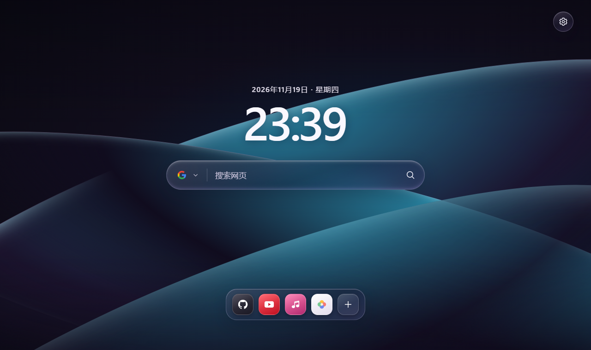

# 流光新标签页

给 Microsoft Edge 的液态玻璃新标签页。中央是本地时钟和搜索框，底部是可以拖动排序的网站快捷栏。壁纸可以选每日一图、自己的图片或视频，也可以连接本机的 Wallpaper Engine 库。



## 下载

打开 [GitHub 最新版本](https://github.com/bilbillm/liuguang-new-tab/releases/latest)，在 **Assets** 中选一个 ZIP。

| 文件 | 适用场景 |
| --- | --- |
| `liuguang-edge-0.1.13.zip` | 新标签页、搜索、快捷栏、每日一图和本机图片或视频。 |
| `liuguang-edge-0.1.13-windows-x64.zip` | 需要额外接入本机 Wallpaper Engine 库。包含同一个扩展、Windows x64 伴侣和注册脚本。 |
| `SHA256SUMS.txt` | 核对下载文件的 SHA-256 校验值。 |

GitHub 的 **Source code** 是源码快照。普通安装请选择上表的 ZIP 发行包。

## 在 Edge 中加载

1. 把 ZIP 解压到长期保留的文件夹，例如 `文档\流光新标签页`。解压后应能看到 `extension\manifest.json`。
2. 在要启用流光的 Edge 配置文件中打开 `edge://extensions`，开启 **开发人员模式**。
3. 点击 **加载解压缩的扩展**。窗口较窄时按钮可能只显示图标，可以悬停查看名称。
4. 在文件夹选择器中选中解压后的 **extension** 文件夹，点击 **选择文件夹**。
5. 按 `Ctrl+T` 打开新标签页。如果 Edge 询问是否保留更改，请选 **保留更改**。如果已有其他新标签页扩展开启，先关闭它，再打开一个新标签页。

打开 **设置 → 背景** 后可选择每日壁纸，或导入 JPG、PNG、WebP、AVIF 图片及 MP4、WebM 视频。单个文件上限为 180 MB。默认搜索引擎是 Google，也可选 Bing、百度或使用自定义网址模板。点快捷图标会打开新标签页，右键可编辑或删除，拖动可排序。

[Microsoft Edge 本地加载文档](https://learn.microsoft.com/zh-cn/microsoft-edge/extensions/getting-started/extension-sideloading)

## 可选｜连接 Wallpaper Engine

1. 下载 Windows x64 完整包，按上面步骤加载扩展。确认已经通过 Steam 安装 Wallpaper Engine，并下载了要用的壁纸。
2. 安装 **.NET Runtime 10（Windows x64）**。[Microsoft .NET 10 下载](https://dotnet.microsoft.com/en-us/download/dotnet/10.0)
3. 在 PowerShell 中进入完整包解压目录，运行下列命令。脚本只注册当前 Windows 用户的 Edge 本地伴侣，无需管理员权限。

   ```powershell
   powershell.exe -NoProfile -ExecutionPolicy Bypass -File .\Install-Companion.ps1
   ```

4. 打开 **设置 → 背景**，在 Wallpaper Engine 区块点 **刷新**。列表支持场景、视频和网页筛选，点卡片即可应用。

视频壁纸在 Edge 内播放。场景和网页壁纸需要支持窗口捕获的 Windows 11（内部版本 22621 或更新）。伴侣通过本机 Wallpaper Engine 启动专用窗口，实时显示画面。关闭窗口会中断播放，可刷新并重新选择。壁纸自身的鼠标交互仍在原播放窗口内完成。

## 更新、移动和卸载

- 更新时，下载新版并解压。把新版 `extension` 的文件复制到 Edge 原来加载的同一个目录，再在 `edge://extensions` 找到流光并点 **重新加载**。用过伴侣的用户也要更新 `companion/runtime` 和注册脚本，关闭正在使用壁纸的标签页后再运行新版注册脚本。
- 移动目录后，在 Edge 中重新加载新位置的 `extension` 文件夹，并在新位置重新注册伴侣。需要保留配置和导入的素材时，优先原地更新。
- 在扩展管理页停用或删除流光即可恢复原来的新标签页。曾注册伴侣的用户可以在解压目录运行下列命令撤销注册。

  ```powershell
  powershell.exe -NoProfile -ExecutionPolicy Bypass -File .\Uninstall-Companion.ps1
  ```

## 常见问题

| 情况 | 检查方式 |
| --- | --- |
| 找不到清单 | 选择解压后的 `extension`，这一层应包含 `manifest.json`。 |
| Ctrl+T 显示其他新标签页 | 检查是否装在当前配置文件、已启用流光、关闭冲突扩展，并保留更改。 |
| 壁纸侧栏显示伴侣未连接 | 检查 Windows x64 完整包、.NET 10 Runtime、当前用户的注册状态和解压路径。 |
| 视频能用，但场景或网页无法播放 | 检查 Windows 11 捕获支持，并确保 Wallpaper Engine 能运行及专用窗口保持打开。 |
| 导入视频后无画面 | Edge 需要支持文件里的实际编码。可尝试 H.264 的 MP4 或 VP8/VP9 的 WebM。 |

## 本地数据

设置、快捷方式、导入图片和视频保存在当前 Edge 配置文件。壁纸伴侣通过 Edge Native Messaging 读取本机已安装的 Wallpaper Engine 库。搜索会前往你选择的搜索引擎。需要自动图标的快捷方式会尝试从对应网站获取 favicon。

## 开发

- `extension/` 是无构建步骤的 Manifest V3 扩展。
- `companion/` 是可选的 Windows Native Messaging 伴侣源码。
- [流光视觉与交互规范](docs/design-guide.md)

使用 .NET 10 SDK 构建 Windows x64 伴侣。

```powershell
dotnet publish .\companion\WallpaperCompanion.csproj -c Release -r win-x64 --self-contained false -o .\companion\runtime
```
